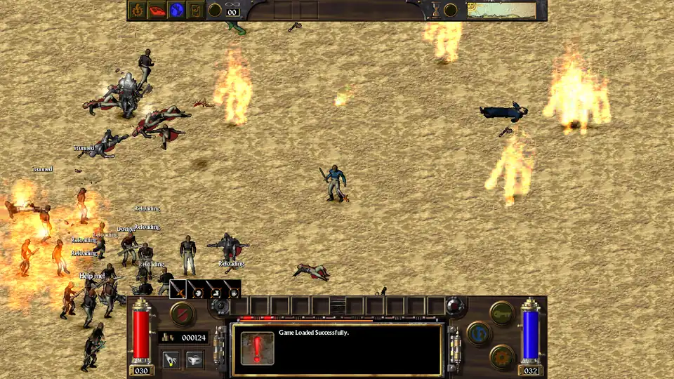

# Arcanum CE — Introduction

Arcanum CE-Combat is an open source rebuild of Troika’s 2001 *Arcanum*, with optional mods focused on bugfixes and combat rebalance.

- Installation builds upon Arcanum 1.0.7.4 from GOG (Good Old Games), with the UAP (Unofficial Arcanum Patch) 2.0.2 and its High Resolution Patch.
- It builds on and extends Arcanum Community Edition by Alex Batalov (`github.com/alexbatalov/arcanum-ce`), a partial decompilation of the original game.
- The original’s ‘quirks’ and idiosyncrasies are kept on purpose. Section 6 in [CHANGES.md](CHANGES.md#6-the-originals-quirks-kept-on-purpose) lists reachable quirks.
- **Native on Linux and Windows**, through SDL3 instead of DirectX. Some performance enhancements in testing.
- **Native macOS, as yet untested.**

> No pretensions to any originality in this work.
>
> Coding was done nearly entirely using LLM tools, Claude, Astra and Deepseek.
>
> This project extends A. Batalov’s work for Arcanum Community Edition.
>
> **My grateful acknowledgement to Messrs. Tim Cain, Leonard Boyarsky and Jason Anderson, Troika Games, Drog Black Tooth, Alex Batalov, the Terra-Arcanum team, Warlockracy, and Kababji, who introduced me to this game’s demo disc all those years ago.**

#### Highlights

- **Follower AI fixes/extensions** focused on magic casting and healing (extensive changes to combat AI of both followers and enemies)
- **Critical combat events overhaul** (more, but less severe criticals, to give feedback during combat)
- **Guns and armor** (rebalance and new mechanics)
- **Sight and hearing revision** (changes to enemy AI sensory)
- **Prowling/stealth revision**
- **Traps and traps skill overhaul**
- **Fumbles revision** (negative criticals/self criticals)

## 1. Mods

### 1.1 Real-Time Pacing - `mod real-time-pacing`

**Real-time combat revised to mirror turn-based combat more accurately. The game remains balanced around turn-based combat.** This rebalance was started in response to the ‘Harm’ and ‘Bow’ bugs in real-time combat. Ready/delay frames used in lieu of revised animations.

- **One turn equivalent to 2 seconds.**
- **Instant actions stay instant:** doors, containers, pickpocketing.
- **Moving costs fighting time:** animation recovery pauses while you walk or run, as in turn-based.
- **A melee swing whose target stepped out of reach costs nothing** [compromise with AI mods].
- **A melee enemy swings only at a target that has stopped**, not at one running past.
- **Potions take time:** drinking potions in real-time combat requires standing still; the effect comes at the end.

### 1.2 Combat Rebalance Mod

**Press Q to reload a gun.** Guns have a magazine/cylinder mechanic and must be reloaded. (Placed at the start as it is not articulated well in-game.)

#### Firearms

- **Reloading.** Pressing **Q** reloads firearms:
    - Some firearms: one shot reloads at a time, topping off. Some guns refill a whole magazine.
    - During turn-based combat, unfinished reloading carries over to the next turn.
    - Real-time player must stand still while reloading.
    - Followers and enemies reload, top up and switch to a melee backup if necessary.
    - Ammo counter revised in UI.
- **Gun criticals added and balance attempted.**
- **Jams:** a firearm’s fumble (negative critical) jams it. Clearing the jam costs one reload typically.
- **Higher to-hit and criticals on the first shot, if undetected.**

#### Armor

- **Armor rebalanced.**
- **Criticals and called shots find gaps** in enemy armor.
- **Shields block.** Shields block damage instead of just contributing to AC.
- **Blunt weapons deal fatigue damage through armor.**

#### Opponent AI

- **Enemies with more than one weapon will choose based on target.**
- **Significant overhaul of caster/summoner behavior**, fixed bugs which made NPCs reluctant to cast.
- **Modifications to NPC combat behavior**, to be more AP efficient.
- **Enemy NPCs will drink potions if available.**

#### Follower AI

Significant revisions to longtime follower AI complaints.

- **Casting behavior.** In vanilla Arcanum, a follower often rolled zero chance at all to cast spells! The follower would refuse to cast if the follower and player character were above half health, unless its foe outranked (outleveled) it. A mage such as Arronax (level 50) or Raven punched through most fights due to their high level (rank). *Now:* most caster followers use their spells and summons similar to enemy NPC casters. Fighters who know a spell or two keep their original behavior, but this change to NPC AI also encourages them to cast more spells.
- **A fatigue reserve while everyone is healthy.**
- **Arronax casts every spell he knows** — all seven, not only the highest of each college, as his map entry otherwise insists. This was always a criticism in classic Arcanum. Arronax follower AI is still buggy, but I consider it a significant improvement.
- **No wasted turns on spells that cannot reach** (useful to discourage low-range AOE).
- **Protections/buffs go on the Player Character first.**
- **Better healing coverage every turn**, priority by health status.
- **A fatigued healer heals instead of sharing fatigue restorer.**
- **Followers will not heal strongly technological characters** (high rate of failure anticipated).
- **Followers have more leeway and behave more predictably under Player Character orders.**
- **Followers retain gear the Player asks them to wear/use.**
- **Idle followers no longer pick up nearby items** (NPCs still do this).

#### Creatures

- **Added new criticals for ‘critter’ enemies.**
- **Phantoms (high level enemies) are hurt only by critical hits, spells, explosions and traps.**
- **More critical hits, each has a temporary effect:** Winded, Numbed arm, Hobbled, Staggered or Dazzled. Injuries rarely last to disfigure a player character.
- **Stun invulnerability for 1 turn after recovering from a stun.** Player Character only (needs testing).

#### Magic

- **Per-spell costs:** 4 to 7 AP by rank, 1 less in a mastered college.
- **The aptitude damage bonus reduced by 30%.**
- **Spell criticals, added.** Damaging spells add damage and a stun or knockdown; Weaken, Drain Will, Plague of Insects, Shrink and Congeal Time leave their target Exposed, Unfocused, Dazzled or Hobbled for two turns; other spells return their casting fatigue.
- **No stacking:** a second casting of a buff does not add to the first.
- **Summoning sickness:** a creature summoned in combat waits a turn (or 2 seconds in real time) before acting.

#### Traps

- **Traps skill is stronger, to reward even a modest investment.**

#### Weapons

- **Swapping weapons from inventory** costs 4 AP.
- **A throw you cannot pay for is refused** (fixed a bug for zero action point throws).
- **A weapon’s on-hit spell** costs no AP [bugfix for rare weapons which cast on hit].
- **The Throwing Dagger bug fixed**, throwing daggers now work as designed.

#### Fumbles / self-inflicted criticals

A fumble with a melee weapon, a bow, a thrown weapon or bare hands no longer always strikes its wielder:

| What happens | Chance | Effect |
|---|---|---|
| **Knocked down** | 50% | You stumble and fall; getting up costs 6 AP in turn-based (other knockdowns, 5). |
| You hit yourself | 30% | For the weapon’s full damage. |
| **Weapon dropped** | 15% | It lands beside you; bare hands stumble instead. |
| You hit yourself critically | 5% | With a critical’s effects. |

This should reduce tragic early-game accidents which discourage new players.

#### Grenades

- **Grenades damage and AOE effect overhaul.**

#### NPC Sight and Hearing

Tightly coupled with the prowling overhaul. NPCs notice you less easily, above all through walls.

**Quest and dialogue scripts keep the original checks, so no quest changes.**

- **Walls and closed doors stop ordinary noise.**
- **Standing still makes no noise.**
- **Being heard only draws a look** — à la *Hitman 2: Silent Assassin*. This may cause unusual NPC behavior.
- **Windows, glass doors and fences don’t hide you.**
- **Poison overhaul**, to make it less punishing in the early game.
- **Backstab revised to be less powerful**, due to low AP cost of daggers.
- **Prowling made much easier/stronger** — needs playtesting.

### 1.3 Called Shots - `mod called-shots`

- **A new UI panel beside the combat bar:** Body, Head, Arms, Legs. Your attacks aim there until you choose again or leave combat mode.
- **Arcanum’s own aimed attacks still work.**

### 1.4 Followers - `mod followers`

- **Easier to recruit and retain followers regardless of Good/Evil alignment**, to encourage sandbox playstyle.

### 1.5 Initiative and Awareness - `mod initiative-awareness`

- **Player party rolls for initiative during combat encounters.**
- **Overhaul of random encounters**, gives chance for player party to avoid encounters based on Perception.

### 1.6 Better Shops - `mod better-shops`

- **Changed shops to better accommodate sandbox playstyle.**

### 1.7 Starting Gold - `mod starting-gold`

- **Tripled starting gold to encourage early game.**

### 1.8 Brighter Lanterns - `mod brighter-lanterns`

- **Makes lanterns (map and player carried) brighter.**

### 1.9 Encounter Variety - `mod encounter-variety`

- **Experimental mod to expand the variety and difficulty of random combat encounters.**

### 1.91 Combat Music Shuffle - always on

- **Varied combat music** (`combat music shuffle`). The original loops one track through every fight, a copy of the dwarven theme; the mod plays a random track from the OST.

## 2. Selected Bugfixes

#### Mistakes in the decompilation, now fixed

- **Random encounters were always the same.**
- **Wall of Fire only damaged friendly side.** (This behavior is still buggy, under investigation.)
- **The 2001 Troika patch never applied.**
- **A follower with followers (summoned creatures) froze the game.**
- **Healing crippled legs cured blindness but left the legs crippled.**
- **The moon ran fast**, 14 hours short every lunar month.
- **Free goods.** A merchant’s item dropped outside the trade window landed on the floor.
- **Every script division added instead.** Each division in every shipped script returned the sum of the two numbers. (#45)
- **Dodge was worth five points a level** instead of 2 (vanilla).
- **Stunned enemies kept fighting.**
- **The dice game vanished in conversation.**
- **Every effect multiplier was zero**, and carrying the Flow Reaper crashed the game. (#60) — crash fixed, under investigation.

#### Bugs of the original game, now fixed

- **A failed save could destroy the one it replaced.**
- **Quitting during a conversation crashed the game.**
- **Walking through walls.** Walking a plotted path while the game checked whether you could see an item’s owner turned the player on the spot, so they ran straight through obstacles.
- **Magic mastery spell cost bug.**
- **Charm spell could leave permanent effects.**
- **Spell glows could stay on for good.**

#### Quirks of the original, kept on purpose

- **The called-shot cursor shows the wrong limb.** Aim at the arms and you see the leg cursor (mouseover). The blow still goes where you aimed.
- **The Grenade Launcher’s explosion can hit you** and anyone beside you.
- **Everyone swings high at dwarves and halflings**; every character counts as human-sized.
- **Mirror reflects no damage.**
- **Hexed items can always be taken off.**
- **Two ghouls and a soul are not undead** to the engine: Savage Ghoul, Stygian Ghoul, Ensanguine Soul.
- **Spells are learned on Willpower**, whatever the spell list says about Intelligence.

## 3. Bug Fixes

- Extensive bugfixes, both to the vanilla game + UAP patch, and to the original Arcanum-CE decompilation project. Details in [CHANGES.md](CHANGES.md).

## A demonstration



A test battle in real time, all nine optional mods on: sixty Tarant guards
with rifles against ten Sir Garrick Stouts, two Elder Joachims and Arronax.

## Playing

You need Arcanum from GOG (Good Old Games) and the Unofficial Arcanum Patch
2.0.2 (`UAP2.0.2.exe`).

Download the mod package for your system from
[Releases](https://github.com/zsogg/arcanum-ce.combat/releases). Each comes with a README covering installation,
playing, the optional mods and removal; the same guides are below:

- **Windows:** install GOG Arcanum and UAP: **Do not install Arcanum into your Program Files directory**, as this mod will be unable to write there.
- After installing Arcanum and the UAP patch, unzip this package - downloads below,
  run `setup.bat`. Setup changes nothing outside the game folder.
- **Linux:** setup builds the game folder from GOG's offline installer and
  `UAP2.0.2.exe` with `innoextract` and `7z`. No Wine is used.

The original `Arcanum.exe` stays untouched and playable.

Arcanum CE keeps its own saves (`modules/Arcanum/SaveCE`) and settings
(`arcanum-ce.cfg`).

**Not supported:** movies play only on Windows (they are skipped on Linux
and macOS), multiplayer is not supported at present.

## Building from source

The libraries the mod needs are vendored under `third_party/`. Builds use CMake
presets:

```console
cmake --preset linux-x64-release
cmake --build --preset linux-x64-release        # out/build/linux-x64-release/arcanum-ce
```

The Windows build is cross-compiled with MinGW-w64
(`x86_64-w64-mingw32-gcc`):

```console
cmake --preset windows-x64-mingw
cmake --build --preset windows-x64-mingw        # out/build/windows-x64-mingw/arcanum-ce.exe
```

The unit tests build with `linux-x64-debug` (or `linux-x64-release-tests`)
and run as `tests/arcanum-tests` in the build folder.

Android, iOS and ARM presets come from upstream; they are not built or tested
here.

The macOS build is experimental: our workflow
(`.github/workflows/macos-build.yml`) compiles it and runs the C suite on a
GitHub runner. If you have a Mac and want to help,
[docs/MACOS-PORT.md](docs/MACOS-PORT.md) is the guide, written to be handed
to an LLM assistant as well.

## License

The source code in this repository is available under the
[Sustainable Use License](LICENSE.md), the license of the upstream project,
[Arcanum Community Edition](https://github.com/alexbatalov/arcanum-ce) by
Alexander Batalov. In upstream's words: "The source code is this repository
is available under the Sustainable Use License."

- **This is a modified version** of that software, as its license requires
  this notice to say. The modifications are under the same license.
- **Free, non-commercial distribution only:** the license permits
  distributing the software only free of charge, for non-commercial
  purposes.
- **Third-party libraries** keep their own licenses, in `third_party/`
  (SDL3, SDL3_mixer, zlib, fpattern).
- **Arcanum** is (c) Troika Games and Sierra. Nothing of the game is in this
  repository or its releases; you need your own copy.
